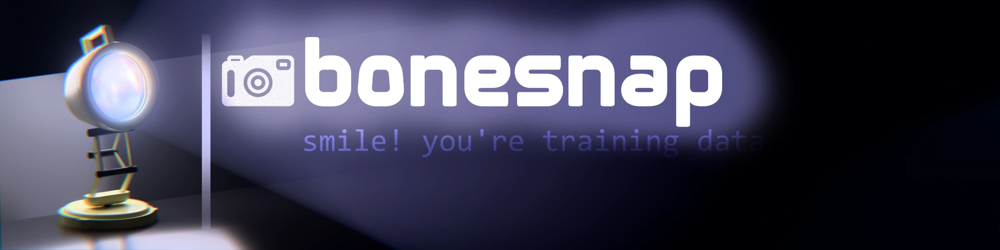
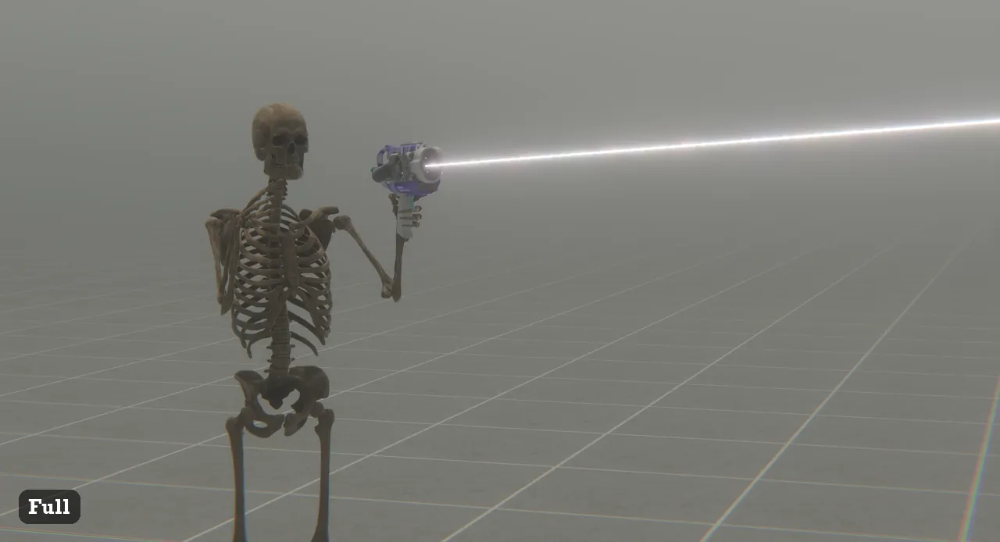
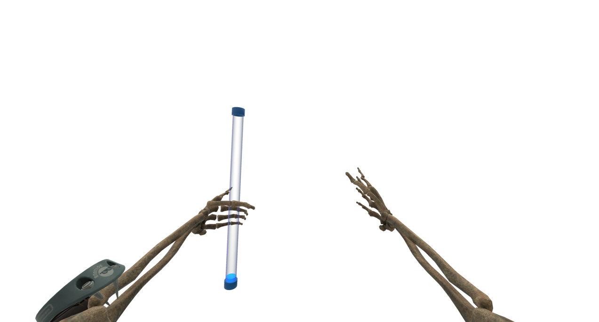
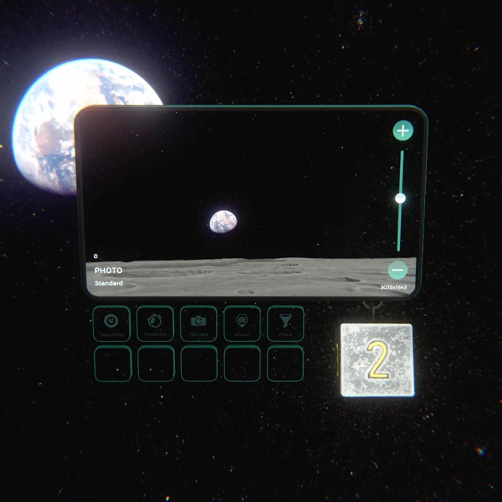

# `📷 bonesnap`

[Thunderstore](https://bonelab.thunderstore.io/package/Fizzyhex/BoneSnap) ↔ [GitHub](https://github.com/Fizzyhex/bonelab-bonesnap)

- accurate high-res captures and screenshots
- compositing
- compatibility with the SNAP CAMERA spawnable - a handheld camera.
- personalisation
- avatar cloning for scene makers

## Features

### Compositing

Compositing allows you to render out multiple layers, which is perfect for photo editing, mod thumbnails and alike. These support avatar clones, too.

**Transparency**

Use the `Mask` compositing mode to output captures with support for transparent objects:

*need to capture an object without your arms? hold it in the air and capture it with the `Hide Rigs` setting!* 

### Compatibility

You can use the SNAP CAMERA, or don't! `Screen` mode works with anything that appears on your monitor, and you can disable BoneSnap's post processing to use it with mods like WideEye.

### Quality Control

BoneSnap will output as a lossless image (PNG) by default, you can optionally reduce the quality to output as a JPG and save on file storage.

### Snap Camera

Your companion camera. You can take selfies, adjust the zoom, anchor it in the air, and more. It's a lot more fun than using the BoneMenu sometimes :) 

optional 2mb download. get it thru the bonemenu!

### Fusion Support

The following things are sync across the network for others in the lobby:

- Snap Camera personalisation (colour/trinket)
- Avatar Clones (only if opted into!)

#### SteamVR Captures

If you have Fusion installed, captures can be saved to your library via Steamworks! Opt-in via `More Options -> Steam`.

## Privacy Statement

Your data is processed. Its sold. WE USE IT. We train on it. We use it to train our models. Our models will be you. They will be us. Every photo isn't just sent—It's a data point. On You. — On us.———On YOU.

## ♥ Thanks

- @TrevTV & @yellowyears – Debugging with initial release
- @Checkerb0ard & FragileDeviations – Fixing for patches (am lazy)
- [Fusion](https://github.com/Lakatrazz/BONELAB-Fusion) – Mod.io Downloader Code